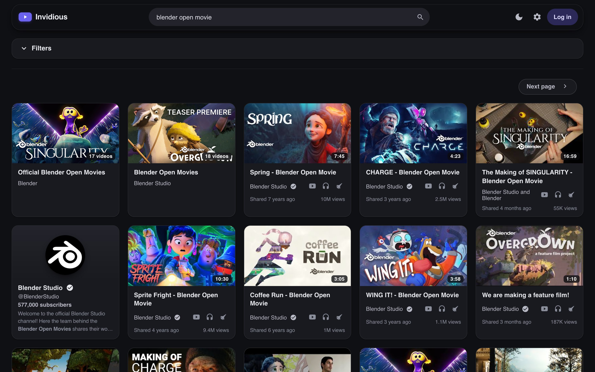
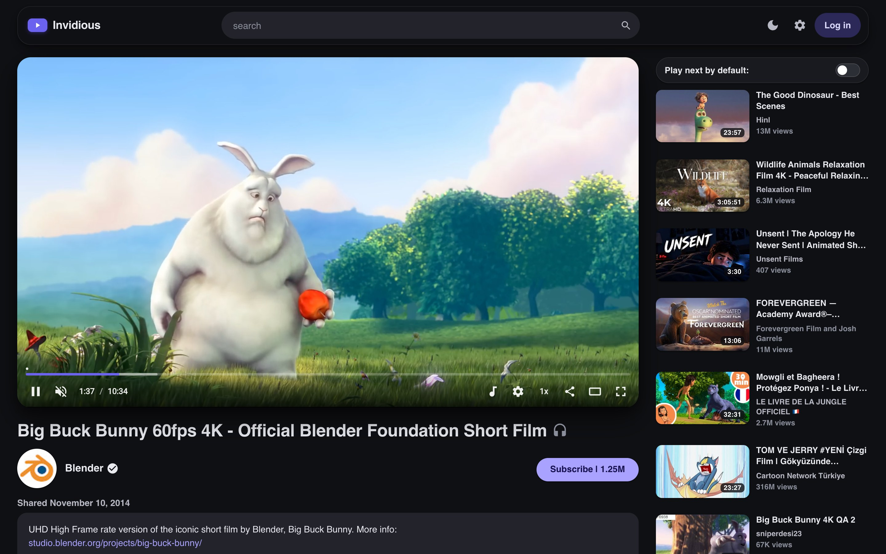

# invidious-highda-restyle

A restyle for [Invidious](https://github.com/iv-org/invidious). It's an overlay: one CSS file
and one JS file that the reverse proxy injects into the pages. Invidious itself isn't patched
or rebuilt.

Made for Invidious `2026.09.30-1454ead` (master) with invidious-companion. I've mostly tested
it in Chromium-based browsers.





<sub>Screenshots show Blender Studio's open movies and Big Buck Bunny, (c) Blender Foundation,
CC BY. Other thumbnails belong to their respective owners.</sub>

## What it does

Look:

- Light, dark and system theme. The colours are CSS variables at the top of `src/theme.css`.
- Floating top bar that hides when you scroll down and comes back when you scroll up.
- Cards for videos, channels and playlists, chips for feeds and sort options.
- Restyled preferences, login, search filters, subscription and token manager, history,
  playlist page and playlist editor.
- Material icons instead of Ionicons.

Watch page:

- On wide screens the recommendations (and the playlist, if you're in one) sit next to the
  player, like on YouTube.
- Restyled video.js player, menus and captions settings.
- Cinema mode, toggled from the player or with `t`.
- Prefers H.264. AV1 and VP9 are hidden from the player, because some browsers say they can
  decode AV1 and then can't (Edge on Windows without the AV1 extension, for example).
- A small service worker retries video segments that failed, so a short hiccup on the
  companion doesn't freeze playback for half a minute. video.js 7 doesn't retry segments
  on its own.
- Captions served by the companion load again. Invidious trims YouTube's track names
  (`English - en` becomes `English`) and the companion then can't find the track and answers
  404, so the script asks for the track by language code instead.
- Reddit comments are hidden, and the `try-reddit-comments-link` TypeError from `watch.js`
  is gone.

Motion: page transitions, theme and cinema switching, the description expanding, and smooth
wheel scrolling. All of it is off with `prefers-reduced-motion`.

It still works with JavaScript disabled. The layout and theme are plain CSS, and the player
falls back to the browser's own `<video>` with the MP4 source.

## Files

```
src/theme.css   stylesheet source
src/app.js      script, loaded in <head> before video.js
src/sw.js       service worker for the segment retries, has to be served as /sw.js
build.py        builds dist/theme.css (adds the icons) and copies the JS
dist/           what you deploy
examples/       config snippets
```

`dist/` is checked in, so you don't need to build anything to use it. If you change `src/`,
run `python3 build.py`.

## Setup

Mount the files into Invidious' static folder
([examples/docker-compose.volumes.yml](examples/docker-compose.volumes.yml)):

```yaml
services:
  invidious:
    volumes:
      - ./dist/theme.css:/invidious/assets/css/restyle.css:ro
      - ./dist/app.js:/invidious/assets/js/restyle.js:ro
      - ./dist/sw.js:/invidious/assets/sw.js:ro
```

`sw.js` has to stay at `/sw.js`, otherwise the service worker can't cover the whole site.

Then inject both into the HTML pages in nginx
([examples/nginx-inject.conf](examples/nginx-inject.conf)):

```nginx
location ~ ^/(?!(css|js|videojs|fonts|vi|ggpht|sb|api|companion|favicon|apple-touch|android|safari-pinned|site\.webmanifest|robots\.txt|opensearch\.xml)) {
    proxy_pass http://invidious:3000;
    proxy_set_header Host $host;
    proxy_set_header Accept-Encoding "";
    sub_filter_once on;
    sub_filter '<head>'  '<head><script src="/js/restyle.js?v=1"></script>';
    sub_filter '</head>' '<link rel="stylesheet" href="/css/restyle.css?v=1"></head>';
}
```

The regex only matches pages. Static files, thumbnails, the API and the companion go through
your usual `location /` and keep their gzip. `sub_filter` can't edit compressed responses,
which is why `Accept-Encoding` is cleared here.

Restart Invidious afterwards. It caches static files in memory, so it won't notice changed
files until it restarts.

When you update: replace the files, restart Invidious and bump `?v=` in both lines. Invidious
tells browsers to cache `/css/` and `/js/` for a month.

If you want Reddit comments off for new users too, set this in the Invidious config:

```yaml
default_user_preferences:
  comments: ["youtube", ""]
```

## Notes

- It works with Invidious' default Content-Security-Policy, nothing needs to be loosened.
- The service worker only handles `GET .../companion/videoplayback`. To get rid of it, deploy
  a `sw.js` that calls `self.registration.unregister()` on activate. Just deleting the file
  leaves it installed in browsers that already have it.
- The selectors follow the current Invidious markup, so a newer Invidious may need fixes.

## License

AGPL-3.0, same as Invidious. See [LICENSE](LICENSE). The icon paths in `build.py` come from
Google's Material Icons, which are Apache 2.0.
